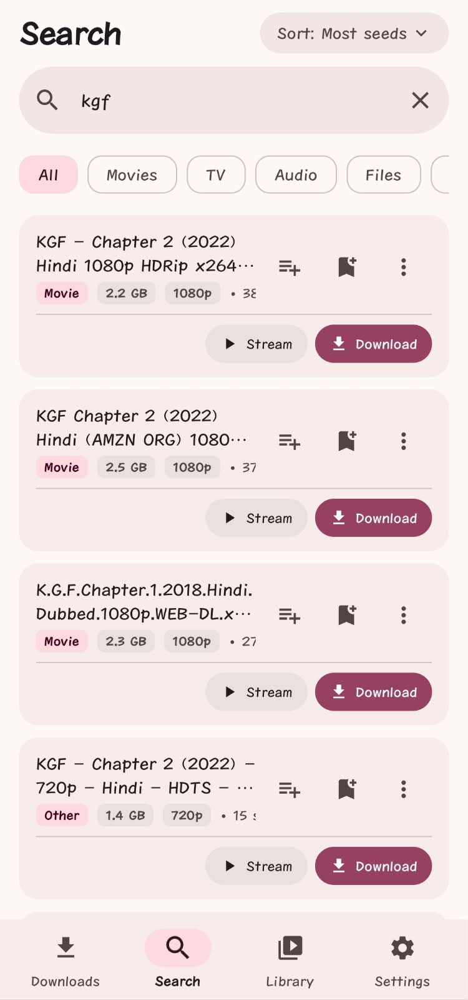
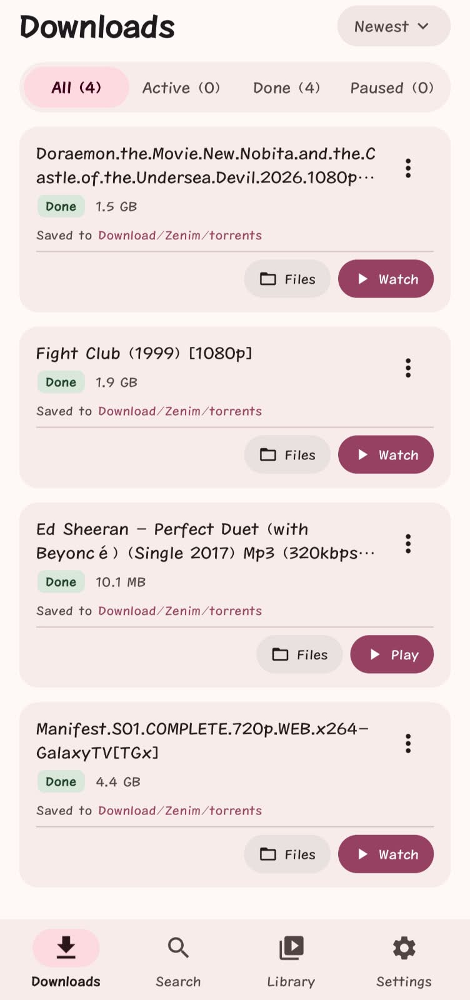
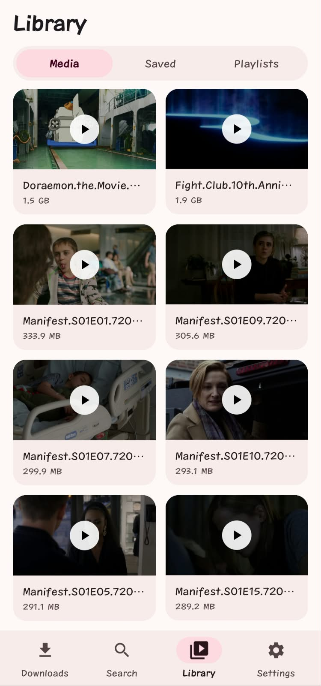

# Zenim 🌸

**A calm, pretty torrent client for Android** — search, download, and
stream torrents directly on your phone, wrapped in a soft Material 3
Expressive look built around a rose palette.

  
  &nbsp;&nbsp;
  
  &nbsp;&nbsp;
  

## ✨ Highlights

- **Search** — live torrent results with sort modes, category filters
  (All / Movies / TV / Audio / Files), quality badges, seed info, per-result
  copy magnet / save `.torrent` actions, and a save-to-downloads flow
- **Stream while downloading** — watch a video or listen to audio *before*
  the torrent finishes: priority pieces + a local range server feed any
  player (built-in media3/ExoPlayer is the default)
- **Downloads** — pause / resume / recheck, per-torrent file picking
  (download all or cherry-pick files), speed & connection limits,
  sequential mode for streamers
- **Library** — 2-column poster grid with auto thumbnails for everything
  you've saved; tap to play in the built-in player (rotate, speed, 10 s
  skip, captions)
- **Streaming bar** — while a torrent streams, a phone-style bar keeps it
  alive; it parks itself cleanly when playback ends
- **Look & feel** — Material 3 Expressive, dark / light / AMOLED + five
  palettes (System, Violet, Blue, Green, Amber, Rose)
- **Update checker** — the app checks this repo's `updater.js` on startup
  and offers newer releases in-app (mandatory updates refuse to dismiss)

## 📲 Install

Grab the APK from **[Releases](https://github.com/israrxy/zenim-android/releases/latest)**
and install it (`allow unknown apps`). Or let the app itself tell you when
an update is live — that's the in-app updater.

Minimum Android: **7.0** (API 24) · target: modern Androids up to **API 36**.

## 🧩 Tech

Jetpack Compose + Material 3 Expressive · libtorrent4j (native libtorrent)
· Kotlin coroutines/Flow · media3 ExoPlayer for in-app playback.

## 👤 The developer

Built by **israrxy** —
[GitHub](https://github.com/israrxy) ·
[Instagram](https://instagram.com/israrxy) ·
[Website](https://israrxy.qzz.io)

## 📄 License

See [LICENSE](LICENSE).
